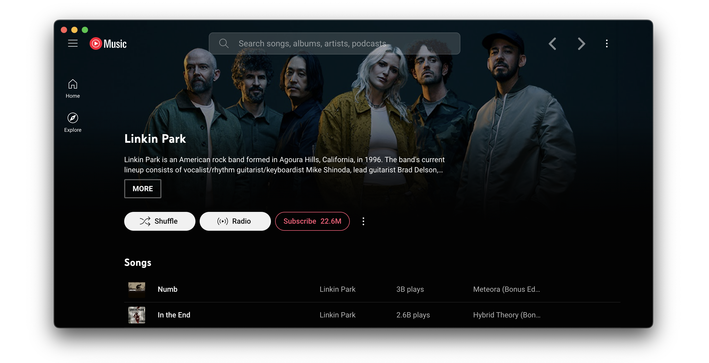

<div align="center">

# :pear: Pear Desktop

[](https://github.com/pear-devs/pear-desktop/releases/)
[](https://github.com/pear-devs/pear-desktop/blob/master/license)
[](https://GitHub.com/pear-devs/pear-desktop/releases/)
[](https://GitHub.com/pear-devs/pear-desktop/releases/)
<!--[](https://aur.archlinux.org/packages/pear-desktop-bin)-->
[](https://snyk.io/test/github/pear-devs/pear-desktop)

</div>

<!---->

- Native look & feel extension

> [!IMPORTANT]
> ⚠️ Disclaimer
>
> **No Affiliation**
>
> This project, and its contributors, are not affiliated with, authorized by, endorsed by, or in any way officially connected with Google LLC, &#89;&#111;&#117;&#84;&#117;&#98;&#101;, or any of their subsidiaries or affiliates. **This is an independent, non-profit, and unofficial extension developed by a team of volunteers with the goal of providing a desktop experience.**
>
> **Trademarks**
>
> The names "Google" and "&#89;&#111;&#117;&#84;&#117;&#98;&#101; Music", as well as related names, marks, emblems, and images, are registered trademarks of their respective owners. Any use of these trademarks is for identification and reference purposes only and does not imply any association with the trademark holder. We have no intention of infringing upon these trademarks or causing harm to the trademark holders.
>
> **Limitation of Liability**
>
> This application (extension) is provided "AS IS", and you use it at your own risk. In no event shall the developers or contributors be liable for any claim, damages, or other liability, including any legal consequences, arising from, out of, or in connection with the software or the use or other dealings in the software. The responsibility for any and all outcomes of using this software rests entirely with the user.

## Content

- [Features](#features)
  - [Plugins](#plugins)
- [Translation](#translation)
- [Download](#download)
  - [Arch Linux](#arch-linux)
  - [Solus](#solus)
  - [MacOS](#macos)
  - [Windows](#windows)
    - [How to install without a network connection? (in Windows)](#how-to-install-without-a-network-connection-in-windows)
- [Themes](#themes)
- [Dev](#dev)
- [Build your own plugins](#build-your-own-plugins)
  - [Creating a plugin](#creating-a-plugin)
  - [Common use cases](#common-use-cases)
- [Build](#build)
- [Production Preview](#production-preview)
- [Tests](#tests)
- [License](#license)
- [FAQ](#faq)

## Features

- **Plugins** for everything from an ad blocker and synced lyrics to Discord, Last.fm and OBS integrations (see the list below).
- **Settings without restarts**: enable, disable and configure plugins from the in-page settings (<kbd>Ctrl</kbd>+<kbd>,</kbd>, or *Pear Desktop settings* in the sidebar). The same settings open in their own window from the tray or with the `--settings` flag, even when YTM doesn't load.
- **Themes**: your own CSS files on top of YTM, reloaded when you edit them.
- **API server** (off by default): a REST and WebSocket API for remotes and stream overlays, documented at `/swagger`.
- **Your settings carry over** from pear-desktop 3.x, which used the same `config.json`.

### Plugins

| id | name | what it does |
|---|---|---|
| `album-actions` | Album actions | Like or dislike every track of an album or playlist at once. |
| `album-color-theme` | Album color theme | Tints the interface with the colors of the current track's artwork. |
| `ambient-mode` | Ambient mode | Surrounds the video or cover art with a soft glow of its own colors. |
| `amuse` | Amuse | Show the current song in the Amuse now-playing widget by 6K Labs. |
| `audio-compressor` | Audio compressor | Evens out loud and quiet parts with a dynamics compressor. |
| `auth-proxy-adapter` | Proxy | Sends all traffic through an HTTP or SOCKS proxy, including ones that need a username and password. |
| `blur-nav-bar` | Blur navigation bar | Makes the top bar translucent with a blur behind it. |
| `captions-selector` | Captions selector | Pick the captions language from the player bar, and optionally load it automatically. |
| `clock` | Clock | Shows the current time in the top bar. |
| `crossfade` | Crossfade | Fades out the end of a track and fades the next one in. |
| `custom-output-device` | Custom output device | Play through a chosen audio device instead of the system default. |
| `disable-autoplay` | Disable autoplay | Starts every track paused instead of playing it automatically. |
| `discord` | Discord Rich Presence | Show your friends what you're listening to in your Discord status. |
| `do-not-track` | Do Not Track | pear-desktop's ad and tracker blocker: strips ads and tracking data from the player, or filters requests with blocklists, skips ads that still play, and dismisses the Premium reminder YTM shows after them. |
| `downloader` | Downloader | Downloads songs, albums and playlists to play offline from the Downloads page in your Library, and saves them as tagged audio files with cover art (on request, or always for those upgrading from pear-desktop 3.x), using yt-dlp for what it can't get itself. |
| `equalizer` | Equalizer | A 10-band equalizer with presets. |
| `exponential-volume` | Exponential volume | Makes the volume slider follow loudness perception, giving finer control at low volumes. |
| `in-app-menu` | In-app menu | Replaces the system title bar: the top bar moves the window and holds the app menu. |
| `lumiastream` | Lumia Stream | Let Lumia Stream react to the songs you play. |
| `media-controls` | Media controls | Control playback from your desktop's media widgets and keys (MPRIS). (linux only) |
| `music-together` | Music Together | Listen in sync with friends: host a session, share the code, and everyone hears the same thing. |
| `navigation` | Navigation buttons | Back and forward buttons in the top bar. |
| `notifications` | Notifications | Show a desktop notification when a new song starts. |
| `performance-improvement` | Performance improvement | Lowers CPU use with CY Fung's scripts: batches the page's timers onto animation frames and reuses YTM's list elements. Takes effect after a restart. |
| `picture-in-picture` | Picture in picture | Watch in a small floating window, from the track menu or a hotkey. |
| `playback-speed` | Playback speed | Adds a speed control to the player bar (scroll over it for fine steps). |
| `precise-volume` | Precise volume | Change the volume in fine steps with the scroll wheel or arrow keys, with a volume readout. |
| `quality-changer` | Video quality changer | Adds a quality picker to the top of the video player. |
| `scrobbler` | Scrobbler | Scrobble what you listen to to Last.fm and ListenBrainz. |
| `shortcuts` | Global shortcuts | System-wide keyboard shortcuts that work while the window is in the background. |
| `skip-disliked-songs` | Skip disliked songs | Skips a track as soon as you dislike it, and whenever a disliked track comes up. |
| `skip-silences` | Skip silences | Skips over silent parts of tracks. |
| `sponsorblock` | SponsorBlock | Skips non-music parts of music videos, using segments crowdsourced by SponsorBlock. |
| `synced-lyrics` | Synced lyrics | Time-synced lyrics in the Lyrics tab, with word-by-word highlighting, click-to-seek and romanization. |
| `taskbar-mediacontrol` | Taskbar media controls | Previous, play/pause and next buttons in the window's taskbar thumbnail. (win32 only) |
| `touchbar` | Touch Bar | The current track and playback controls on the MacBook Touch Bar. (darwin only) |
| `transparent-player` | Transparent player | Makes the window see-through, with a blurred material behind it on Windows 11 and macOS. |
| `tray` | Tray icon | Playback controls and the current track in the system tray. |
| `tuna-obs` | Tuna OBS | Show the current song in OBS through the Tuna plugin. |
| `unobtrusive-player` | Unobtrusive player | Starting a song from a list keeps you where you are instead of opening the full player. |
| `video-toggle` | Video toggle | Switch between a track's music video and its cover art, or hide the video entirely. |
| `visualizer` | Visualizer | Shows a music visualizer in place of the album art on the player page. |

## Translation

You can help with translation on [Hosted Weblate](https://bit.ly/48n5YF7).

<a href="https://bit.ly/48n5YF7">
  
  
</a>

## Download

You can check out the [latest release](https://github.com/pear-devs/pear-desktop/releases/latest) to quickly find the
latest version.

### Arch Linux

Install the [`pear-desktop`](https://aur.archlinux.org/packages/pear-desktop) package from the AUR. For AUR installation instructions, take a look at
this [wiki page](https://wiki.archlinux.org/index.php/Arch_User_Repository#Installing_packages).

### [Solus](https://getsol.us/)

```bash
sudo eopkg install pear-desktop
```

### macOS

You can install the app using Homebrew (see the [cask definition](https://github.com/pear-devs/homebrew-pear)):

```bash
brew install pear-devs/pear/pear-desktop
```

If you install the app manually and get an error "is damaged and can’t be opened." when launching the app, run the following in the Terminal:

```bash
/usr/bin/xattr -cr /Applications/Pear\ Desktop.app
```

### Windows

You can use the [Scoop package manager](https://scoop.sh) to install the `pear-desktop` package from
the [`extras` bucket](https://github.com/ScoopInstaller/Extras).

```bash
scoop bucket add extras
scoop install extras/pear-desktop
```

Alternately you can use [Winget](https://learn.microsoft.com/en-us/windows/package-manager/winget/), Windows 11s
official CLI package manager to install the `pear-devs.pear-desktop` package.

*Note: Microsoft Defender SmartScreen might block the installation since it is from an "unknown publisher". This is also
true for the manual installation when trying to run the executable(.exe) after a manual download here on github (same
file).*

```bash
winget install pear-devs.pear-desktop
```

#### How to install without a network connection? (in Windows)

- Download the `*.nsis.7z` file for _your device architecture_ in [release page](https://github.com/pear-devs/pear-desktop/releases/latest).
  - `x64` for 64-bit Windows
  - `ia32` for 32-bit Windows
  - `arm64` for ARM64 Windows
- Download installer in release page. (`*-Setup.exe`)
- Place them in the **same directory**.
- Run the installer.

## Themes

You can load CSS files to change the look of the application (Settings > Appearance > Themes). A theme is reloaded when
you edit its file.

Some predefined themes are available in https://github.com/kerichdev/themes-for-ytmdesktop-player.

## Dev

Requires [nub](https://nubjs.com) and Node 22+.

```bash
git clone https://github.com/pear-devs/pear-desktop
cd pear-desktop
nub install
nub run dev
```

`nub run dev` launches the app and rebuilds it when you change the code. With `PEAR_USER_DATA=/tmp/profile nub run dev`
it uses a separate profile; without it, it uses the same data folder as an installed Pear Desktop, so it picks up that
session.

The code is a monorepo:

```
apps/desktop/               Electron main process, preload, tests
packages/sdk/               plugin API, config schema, selector registry, macros
packages/page/              page runtime: player facade, plugin runner, audio graph
packages/ui/                settings (Preact in a shadow DOM)
packages/vite-plugin-pear/  plugin discovery, host/page splitting, page bundling
plugins/<id>/               one folder per plugin
src/i18n/resources/         translations (Weblate)
docs/plugins.md             plugin authoring guide
```

Other useful commands:

```bash
nub run typecheck
nub run i18n         # adds new English texts to src/i18n/resources/en.json (Weblate's source)
```

`nub install` also installs a pre-commit hook (`.githooks/`) that keeps the trademarked name of the music service out of
the sources: it escapes it in JSON files and rejects plain uses in code and docs (write it as unicode escapes in
strings, or "YTM" in prose). CI checks the same.

## Build your own plugins

Using plugins, you can:

- manipulate the app, with the `host` part: the window, the tray, files, other apps
- change the front, with the `page` part and CSS: YTM's page and its player

The complete guide is [docs/plugins.md](docs/plugins.md).

### Creating a plugin

Scaffold a plugin with:

```bash
nub scripts/new-plugin.ts my-plugin
nub install
```

It creates `plugins/my-plugin/index.ts`. The settings UI is made from `config`, so there's no menu to write.

```typescript
import { config, definePlugin } from '@pear/sdk';
import { css } from '@pear/sdk/macros' with { type: 'macro' };

export default definePlugin({
  id: 'my-plugin', // the folder's name
  name: 'Plugin Label',
  description: 'One sentence shown in settings.',
  restartRequired: false, // true: turning it on or off needs a restart
  config: {
    // shown in the settings
    value: config.number(1, { label: 'Value', min: 1, max: 3, step: 1 }),
  },
  style: css`sel(nav_bar) { opacity: 0.9; }`, // applied while the plugin is enabled
  host: {
    start(ctx) {
      ctx.window.maximize();
      ctx.player.on('trackChange', (track) => ctx.log.info('now playing', track?.title));
      // apply setting changes without restarting the plugin
      ctx.onConfigChange((config) => ctx.log.info('value is now', config.value));
    },
    // the page part calls these with ctx.host.invoke('hello', name)
    commands: {
      hello(name: string) {
        return `hello ${name}`;
      },
    },
  },
  page: {
    async start(ctx) {
      console.log(await ctx.host.invoke('hello', 'page'));
      const api = await ctx.player.ready(); // YTM's player
      ctx.setConfig({ value: api.getVolume() > 50 ? 3 : 1 });
    },
  },
});
```

Anything set up through `ctx` is undone when the plugin is turned off, so there's no `stop` to write.

### Common use cases

- injecting custom CSS: `sel(name)` stands for one of the selectors in `packages/sdk/src/selectors.ts`:

```typescript
import { definePlugin } from '@pear/sdk';
import { css } from '@pear/sdk/macros' with { type: 'macro' };

export default definePlugin({
  id: 'my-plugin',
  name: 'Plugin Label',
  style: css`sel(nav_bar) { backdrop-filter: blur(8px); }`,
});
```

- If you want to change the HTML: create elements with JSX in an `index.tsx`, and add them with `ctx.mount`:

```tsx
/** @jsxImportSource @pear/sdk */
import { definePlugin } from '@pear/sdk';

export default definePlugin({
  id: 'my-plugin',
  name: 'Plugin Label',
  page(ctx) {
    const hello = <button class="my-plugin-hello" onClick={() => ctx.toast('hello')}>Hello</button>;
    ctx.mount(hello, 'nav_bar.right', 'prepend');
  },
});
```

- communicating between the front and back: the page calls `host.commands` with `ctx.host.invoke`, and the host
  sends events with `ctx.emit`. See [docs/plugins.md](docs/plugins.md#talking-between-host-and-page).

## Build

1. Clone the repo
2. Follow [this guide](https://nubjs.com) to install `nub`
3. Run `nub install` to install dependencies
4. Run `nub run dist:OS`

- `nub run dist:win` - Windows
- `nub run dist:linux` - Linux (amd64)
- `nub run dist:linux:deb-arm64` - Linux (arm64 for Debian)
- `nub run dist:linux:rpm-arm64` - Linux (arm64 for Fedora)
- `nub run dist:mac` - macOS (amd64)
- `nub run dist:mac:arm64` - macOS (arm64)

Builds the app for macOS, Linux, and Windows,
using [electron-builder](https://github.com/electron-userland/electron-builder), into the `pack` folder.

## Production Preview

```bash
nub run build
nub run --filter @pear/desktop start
```

## Tests

```bash
nub run test        # unit tests (Vitest)
nub run test:e2e    # builds the app, then drives it against the real YTM
```

The end-to-end tests use [Playwright](https://playwright.dev/) to test the app. Never automate Google sign-in in them:
Google rate-limits the whole IP.

On Linux with Xvfb installed, the apps under test open on a virtual display, so they don't take your keyboard focus;
the two tests of maximizing and minimizing need a window manager and are skipped there. `PEAR_E2E_SHOW=1 nub run
test:e2e` opens the apps on your desktop and runs those too.

## License

MIT © [pear-devs](https://github.com/pear-devs/pear-desktop)

## FAQ

### Why apps menu isn't showing up?

If `Hide the menu bar` is on (Settings > Window & Tray) - you can show the menu with the <kbd>alt</kbd> key (or
<kbd>F10</kbd> if using the in-app-menu plugin)

### Why does YTM skip the cookie consent screen?

The app answers it with "only essential cookies" (`SOCS=CAI`), unless you've chosen otherwise on YTM.

### Musixmatch lyrics are wrong or missing?

Musixmatch (synced-lyrics) needs a Musixmatch user token in the plugin's settings: Musixmatch answers anonymous apps
with an all-zero token that only gets decoy lyrics.
